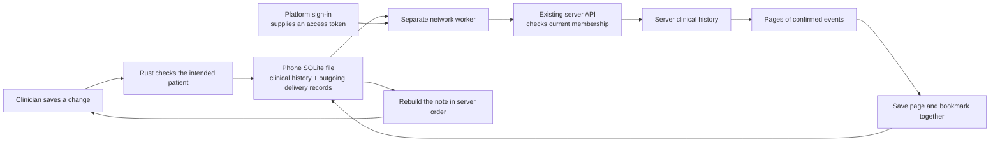
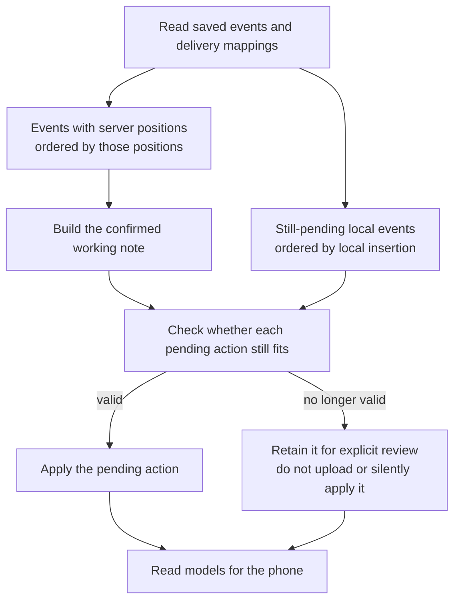
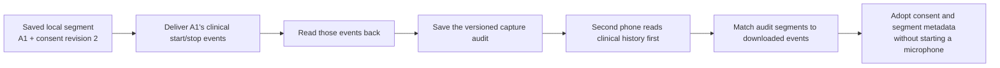

# Phase 5 Step 3: getting the phone and server to agree

Implementation record, 2026-11-17. This follows the [Step 1 bridge](phase5-step1-implementation.md) and [Step 2 device core](phase5-step2-implementation.md). The explanation starts with what a clinician sees, then follows one saved change through the code. The diagrams use Mermaid, which GitHub renders inside Markdown.

## What this step adds

In Step 2, the phone could save its own work. In Step 3, it can deliver that work to the server, receive work back, and remember where it left off when the connection disappears or the app closes.

A lab entered without a connection stays usable on the phone. When a connection returns, the phone registers the shift and patient as needed, sends the original saved change, and waits for confirmation through the server's history. A second phone, used afterward by the same clinician, can recover the active shift, patient list, clinical history, and consent/capture audit records into its own SQLite file.

The server still owns transcription and generated note text. This step moves records; it does not add microphone recording, submit a generation request, or connect to an electronic medical record system.

There are also deliberate boundaries. Templates, saved prompts, pasted chart context, and the separate manual scratch draft still stay on the device. The screen says so. Actual sign-in configuration comes from the platform authentication layer; opening a local store still requires neither a token nor a working server. The checked-in app has no invented staging address or embedded login credentials.

## The picture from the top



The phone's SQLite file remains its working record. A network failure never replaces it with an empty store, switches it to a remote-only repository, or falls back to fixture data.

The new network worker is like a courier working alongside the unit clerk from the Step 2 explainer. The clerk can keep accepting local changes while the courier is waiting at another desk. There is still one owner of the clinical state; network replies come back through that owner's existing command queue.

The main entry points are [the network worker](../../crates/er-device/src/sync.rs), [the decisions and reply handling inside the core](../../crates/er-device/src/sync_core.rs), and [the durable delivery records](../../crates/er-store/src/sync.rs).

## Three things that sound similar but mean different things

Think of the phone as having an outgoing tray, a folder of receipts, and a bookmark in the hospital's master record.

**The outgoing tray:** a delivery row points to a clinical event already saved in SQLite. The event keeps its original identity and contents. Retrying delivery does not create another clinical event or another patient.

**A receipt:** the server says, “I stored event E1 at position 204.” The phone saves that receipt. This establishes that the server accepted E1. It does not prove the phone has read all the other events that came before or around it.

**The bookmark:** the phone has safely stored a page of the server's history through position 204. Only then can it move its download bookmark to 204. The record and bookmark are written in the same database transaction: both succeed, or neither does.

The code calls that bookmark a *cursor*. It calls the outgoing tray an *outbox*. Those are storage names for these two simple jobs.

```mermaid
stateDiagram-v2
    [*] --> SavedLocally
    SavedLocally: Saved locally and waiting to send
    SavedLocally --> Accepted: Receipt stored
    Accepted: Accepted by server and awaiting download
    Accepted --> Confirmed: Matching event downloaded and saved
    SavedLocally --> Confirmed: Lost reply recovered by reading server history
    Confirmed: Confirmed in downloaded history
    SavedLocally --> NeedsReview: Server state makes the pending change invalid
    NeedsReview: Retained for explicit review
    NeedsReview --> Discarded: Clinician explicitly discards this pending event
    Discarded: Kept locally as discarded; excluded from the working note
```

This distinction is why “the upload returned success” is not enough to show “clinical records are up to date.” The phone must have no queued clinical events or unconfirmed receipts, must have completed the relevant history read, and must have reconciled the supported capture-audit data. This statement does not include the settings and chart context that remain local.

## Follow one lab from Room 4

Suppose the clinician enters a synthetic potassium result of 5.8 mmol/L for patient visit A in Room 4. These names are short labels for illustration; actual identifiers are long unique identifiers called UUIDs.

1. The form holds **A's ID**, even if the clinician switches the visible selection to Room 7 before saving. Swift passes A explicitly to the Rust bridge.
2. Rust validates the result and appends `ResultReceived(A)` with an event ID, **E1**. The event body includes the original result ID, value, units, patient identity, and clinical time.
3. The SQLite insert also creates E1's delivery row. That happens as part of the same write. There is no moment where an acknowledged local event exists but its delivery work has been forgotten.
4. The note on the phone updates immediately. Without a connection, E1 remains in the outgoing tray.
5. On a sync round, the network worker obtains an access token from the platform. It calls `/v1/me` to check the server-resolved organization and clinician before sending clinical data.
6. It finds or creates the server shift, then registers A before sending A's events. The server's shift ID is saved as a mapping; A's patient ID and E1's event ID are reused.
7. The phone reads A's new server events first. This can reveal, for example, that the note was signed while the phone was offline. A pending change that no longer fits is retained as a conflict rather than blindly uploaded.
8. If E1 is still valid, the worker sends it in a batch. A successful reply might say `E1 → server position 204`.
9. SQLite saves that receipt. E1 now waits for confirmation by download; the bookmark does not move merely because the receipt arrived.
10. The next history page contains E1, with the same patient and event body. The phone saves the page, marks E1 as downloaded, and advances its bookmark in one transaction.
11. Rust rebuilds A's note in the agreed order and sends a small “something changed” notification. Swift reads the updated views on its background lane and publishes them on the main thread.

```mermaid
sequenceDiagram
    participant Screen as Room 4 form
    participant Core as Clinical command owner
    participant Disk as Phone SQLite
    participant Network as Network worker
    participant Server as Server
    Screen->>Core: Save potassium for visit A
    Core->>Disk: Save E1 and its delivery row
    Disk-->>Core: Durable success
    Core-->>Screen: Local result is available
    Network->>Core: Reserve a request on disk
    Network->>Server: Read membership and establish shift/patient
    Network->>Server: Read A's new history
    Network->>Server: Send the original E1
    Server-->>Network: Receipt E1 = position 204
    Network->>Core: Save receipt; leave download bookmark unchanged
    Network->>Server: Read A's history after the last saved bookmark
    Server-->>Network: Page containing E1
    Network->>Core: Save page and new bookmark together
    Core->>Disk: Commit records + delivery state + bookmark
    Core-->>Screen: Updated clinical view is available
```

The actual write methods are `acknowledge_events` and `receive_page` in [the store code](../../crates/er-store/src/sync.rs). `accept_sync_answer` in [the core code](../../crates/er-device/src/sync_core.rs) handles those replies without letting the network worker mutate the clinical state directly.

## What happens if a reply disappears?

The difficult case is not simply “the internet is off.” It is “the server saved something, but the phone never received the answer.”

Imagine a batch contains E1, E2, and E3. The server saves E1 and then fails. The phone receives an error. It cannot infer that all three failed or that all three succeeded.

The phone therefore retains the original three IDs. On its next allowed attempt, it reads the server's history. That read can confirm E1. Only E2 and E3 remain to send. If it must resend an already accepted ID, the server's existing duplicate handling returns the original server position rather than inserting a second row.

| Moment | Phone's durable knowledge | Next action |
|---|---|---|
| Before the batch | E1, E2, E3 are queued | Send the original IDs and bodies |
| Server saved E1; reply was lost | Still uncertain about all three | Wait, then read server history |
| History confirms E1 | E1 confirmed; E2 and E3 queued | Send E2 and E3 |
| Remaining events confirmed | Three clinical events, no duplicates | Continue normal polling |

Outgoing batches also respect both server limits: at most 500 events and less than the 2 MiB JSON body cap. The phone counts the encoded size, including escaped text, and stops below 1.9 million bytes before adding another event. Larger backlogs keep their remaining original IDs for later batches.

A partial successful response follows the same rule: only the IDs actually listed in its receipts become acknowledged. Unknown IDs, incompatible position mappings, changed event bodies, and malformed page order are rejected rather than being treated as confirmation.

[The integration test](../../crates/er-server/tests/device_sync_gate.rs) deliberately lets the real server save only the first event, then replaces its reply with an error. The eventual server and phone both contain exactly three events. Another test loses the shift-start reply after the shift has already been created.

## Two shift IDs, one shift

The phone must be able to start a shift without contacting the server. It creates a stable local shift ID, say **L1**. The current server API creates its own shift ID, say **S9**.

Step 3 keeps both:

| Phone record | Value |
|---|---|
| Local shift identity | L1; existing local references keep using it |
| Server shift mapping | S9; server requests use this ID |
| Patient visit identity | A; unchanged on phone and server |
| Event identity | E1; unchanged on every retry |

Before creating a server shift, the phone asks for the clinician's existing active shift. If one exists, it uses that shift. If a start request loses its reply, the next attempt asks for the active shift again. It does not invent a `client_shift_id` field or assume a timed-out start did nothing.

Patient registration follows the shift mapping, because the current registration endpoint attaches patients to the clinician's active shift. Pending ended shifts are processed in order before moving on to a newer local shift. A second device with an empty local store imports the existing active shift and roster instead of creating duplicates.

`next_sync_action` and `import_roster` in [sync_core.rs](../../crates/er-device/src/sync_core.rs) contain this sequencing. They preserve server roster order, retain local pending visits, and validate shift/patient references before accepting the result.

## Reading the history in the right order

The phone's local insertion order and the server's clinical-event order are different things. This matters when a worker-generated summary arrives between two local actions.

For example:

| What the phone happened to insert | Local insertion position | Server position |
|---|---:|---:|
| E3: a locally entered result | 1 | 150, once accepted |
| E1: a transcript downloaded later | 2 | 100 |
| E2: a summary downloaded later | 3 | 120 |

The rebuilt note must apply **E1 → E2 → E3**, not blindly use local positions 1 → 2 → 3. Unaccepted local events follow the known server history in their original local order.



Step 2 used saved note shortcuts, called *snapshots*, to avoid rereading the whole event history. Those shortcuts assumed local insertion order. Once sync bookkeeping starts, Step 3 bypasses those shortcuts and rebuilds from ordered events instead. Receipts and downloaded pages also invalidate the affected shortcuts. Reusing the old shortcuts would be faster but could skip an event or produce the wrong order.

The ordering query and shortcut guard are in [repository.rs](../../crates/er-store/src/repository.rs). Pending-action validation and reconstruction are in `rebuild_synchronized_notes` in [sync_core.rs](../../crates/er-device/src/sync_core.rs).

If the server history now says a note is signed, a pending result or review action is not quietly folded into that signed note. It becomes a visible conflict. The bridge exposes the conflicting event IDs and reasons, plus an explicit discard action. Discarding preserves the local history row, marks it discarded, and excludes it from delivery and the working note. A full clinician review screen remains Step 5 work; this is not automatic conflict resolution or concurrent multi-device editing.

## Consent and recording attribution now have their own server contract

Consent was local metadata in Step 2. Putting extra fields into an existing note-event request would not make that metadata supported by the server. Step 3 instead adds a separately versioned contract:

```text
GET /v1/patients/{id}/capture-audit/v1
PUT /v1/patients/{id}/capture-audit/v1
```

It stores two histories for this patient visit and authenticated clinician:

- Consent actions: choice, recorded time, policy version, and increasing revision.
- Recording segments: the existing segment ID, ambient/solo mode, source device, consent revision, start time, and optional confirmed end time.

The server takes organization and clinician identity from authentication. The caller cannot choose an author or organization in the request. Another organization cannot read this patient's audit records, and another clinician does not receive this clinician's consent history through the endpoint.

An update says which version it was based on. Existing consent entries cannot be rewritten or removed. Existing segment attribution cannot be relabeled. An unfinished segment can acquire its confirmed end time once; a completed end time cannot be changed through this contract. An identical resend returns the same version, even when the first reply was lost.

The server also checks each segment against the patient's actual `AudioStarted` and `AudioStopped` events. A segment ID belonging to another visit cannot be smuggled into this patient's audit metadata. These records document clinician actions; they do not certify an institution's consent process or prove a hardware device's identity.



That order prevents a second phone from persisting segment metadata that points to events it has not downloaded yet. If the audit is ahead of the downloaded history, it reads more history first. A restart between two pages can continue downloading; an apparent unfinished segment at the end of a partial page does not permanently block sync.

The shared request/response types and history rules are in [capture_audit.rs in er-api](../../crates/er-api/src/capture_audit.rs). The endpoint is in [capture_audit.rs in er-server](../../crates/er-server/src/capture_audit.rs). [The new server migration](../../crates/er-server/migrations/20261117000000_capture_audit.sql) supplies organization-protected storage; [privileges.rs](../../crates/er-server/src/privileges.rs) grants the API the required access and grants the worker and onboarding roles none.

Templates, saved prompts, pasted context, and scratch drafts are not added to this contract. Their later generation/input contracts remain Step 7 work. A mode preference without a recorded segment also remains local; importing declined consent does not automatically choose solo dictation.

## How a bad connection changes behavior

| What happened | What the phone does |
|---|---|
| No usable response, or a server failure | Keeps the same durable work and waits before retrying |
| Expired access token: HTTP 401 | Asks the platform to refresh once, then verifies membership before continuing |
| Membership denied: HTTP 403 | Shows an authentication problem; does not treat this as ordinary offline operation |
| Patient or mapped resource missing: HTTP 404 | Shows that the record was not found; does not invent a replacement patient ID |
| Server asks the phone to slow down: HTTP 429 | Honors numeric `Retry-After` seconds, bounded between the contract's 60-second wait and one day |
| Conflicting version: HTTP 409 | Retains the pending work and rereads supported metadata; incompatible histories need review |
| Other rejected input | Keeps the failure visible instead of reporting delivery success |
| Different organization, clinician, or server for the bound store | Rejects the connection before sending clinical data |

Ordinary failures increase the waiting period, up to one minute. A server-requested longer wait takes precedence. Waiting periods and recent request times are saved in SQLite, so closing and reopening the app does not reset the limits.

The network client has bounded connection/request waits and does not follow redirects. Production device builds use HTTPS and the Rust TLS transport instead of the old default native-TLS/OpenSSL dependency path. The separate `development-http` feature allows local test servers; production packaging rejects that feature. No App Transport Security exception was added to the phone app. Actual Apple networking/linking remains an Apple acceptance check.

## Polling without overwhelming the server

The server allows 60 general requests per minute per clinician. Eighteen patients polled every ten seconds would already exceed that limit before registration, sign-in checks, or uploads.

The device therefore reserves at most **48 requests in a rolling minute**. It saves each reservation before sending the request. Failed requests and retries count too. The remaining capacity is headroom, not a claim that other devices share this local counter; the server still enforces the combined clinician limit and may return 429.

A normal round checks membership and performs a bounded number of actions. It rotates through patients so one patient cannot keep everyone else waiting. The selected patient's normal history check becomes due sooner than background patients. Pages and pending delivery work can require further rounds; the worker never spins through unlimited pages in one call.

There are two entry points:

- `sync_now` requests a deliberate refresh, including roster discovery, without bypassing request limits or waiting periods.
- `poll_sync` first checks whether anything is due. If nothing is due, it returns without obtaining a token or sending `/v1/me` just to discover that there is nothing to do.

Once an authenticated connection is configured, the Swift service checks for due work every two seconds. This is a foreground development/application loop, not a promise of continuous execution while iOS suspends the app. Actual requests are governed by Rust's durable schedule and budget. Closing the service cancels this loop and releases the token source.

`reserve_request`, `scheduled_sync_due`, and `next_sync_action` in [sync_core.rs](../../crates/er-device/src/sync_core.rs) implement those decisions. [RustDeviceService.swift](../../ios/ErNoteKit/Sources/ErNoteKit/RustDeviceService.swift) supplies the separate network lane and main-thread presentation updates.

## One SQLite file, with a few more records

The local schema advances from version 1 to **version 2**. The existing clinical events, patient metadata, and preference definitions stay intact.

| Record | What it remembers |
|---|---|
| Existing `events` | The original clinical action, identity, and body |
| New `device_event_delivery` | Its server position if known, whether it has been read back, and any conflict/discard status |
| New `device_sync` | Bound server/account membership, patient registration and bookmarks, audit versions, next work times, request budget, and waiting period |
| Existing device shift metadata | The local shift plus its optional server-shift mapping |

An SQLite insert trigger creates the outgoing delivery record when a clinical event is written in a device-scoped database. This covers both normal event publication and the Step 2 transaction that writes a capture boundary with its metadata. The upgrade also creates delivery rows for existing Step 2 events, reusing their original IDs.

Downloaded events are inserted in the same clinical-history table and then marked as received in that same transaction. They do not come back out as new local uploads. Receipts never change a download bookmark. A failed page save leaves the previous bookmark intact, so retrying the page is safe.

The sync bookkeeping payload has its own version marker, `V1`, in addition to the SQLite layout version. Unsupported future formats are not silently interpreted as today's format.

## Files to read when you want to see the implementation

Start with the first three; the rest are supporting pieces.

| File | What it does |
|---|---|
| [er-device/src/sync.rs](../../crates/er-device/src/sync.rs) — new | Runs a network round outside the clinical owner; gets platform tokens, verifies membership, sends existing API requests, handles waiting/refresh behavior, and returns delivery status. |
| [er-device/src/sync_core.rs](../../crates/er-device/src/sync_core.rs) — new | Chooses the next action from durable state; imports rosters and supported audit data; applies replies; rebuilds notes; identifies stale pending actions. It is a child of the existing core module, so private clinical state stays inside the composition root. |
| [er-store/src/sync.rs](../../crates/er-store/src/sync.rs) — new | Typed delivery records, receipt/page transactions, counts, ordered reads, and conflict/discard bookkeeping. |
| [er-store/src/db.rs](../../crates/er-store/src/db.rs) | Adds the version 2 local migration and outgoing-record trigger. |
| [er-store/src/repository.rs](../../crates/er-store/src/repository.rs) | Reads known server order followed by the local tail; bypasses local-order note shortcuts once sync starts. |
| [er-device/src/core.rs](../../crates/er-device/src/core.rs), [handle.rs](../../crates/er-device/src/handle.rs) | Rebuild on reopen, block conflicting edits, and allow only one network round per owned core. Clinical command/runtime ownership is preserved. |
| [er-api/src/client.rs](../../crates/er-api/src/client.rs) | Adds explicit membership, batch, single-page, and capture-audit calls to the existing client. Also adds token replacement, request bounds, redirect policy, and `Retry-After` inspection. |
| [er-api/src/capture_audit.rs](../../crates/er-api/src/capture_audit.rs) — new | The deliberately versioned consent/segment request/response types and rules for extending history. |
| [er-server/src/capture_audit.rs](../../crates/er-server/src/capture_audit.rs) — new | Authenticated read/write endpoint, version checks, stable retry behavior, and validation against patient capture events. |
| [server migration](../../crates/er-server/migrations/20261117000000_capture_audit.sql) — new | Stores audit histories with organization row protection and clinician-qualified identities. |
| [server routes](../../crates/er-server/src/routes.rs), [privileges](../../crates/er-server/src/privileges.rs), [readiness checks](../../crates/er-server/src/state.rs) | Register the path under existing authentication, request limits, access auditing, and no-store handling; grant required database access and require the new table before serving traffic. |
| [er-ffi/src/device.rs](../../crates/er-ffi/src/device.rs) | Adds token callback, sync configuration/status, manual/scheduled sync, conflict listing, and explicit discard. Bridge interface version advances to 3. No token is persisted. |
| [RustDeviceService.swift](../../ios/ErNoteKit/Sources/ErNoteKit/RustDeviceService.swift) | Auth configuration, separate background network queue, due-work timer, explicit close, and fresh presentation data. |
| [DeviceService.swift](../../ios/ErNoteKit/Sources/ErNoteKit/DeviceService.swift), [WorkspaceModel.swift](../../ios/ErNote/WorkspaceModel.swift), [WorkspaceView.swift](../../ios/ErNote/WorkspaceView.swift) | Show queued versus awaiting-confirmation work, plain-language status, and local-only settings/context. Sync stays disabled until actual connection/auth configuration is supplied. |
| [RustBridge.swift](../../ios/ErNoteKit/Sources/ErNoteKit/Generated/RustBridge.swift), [RustCoreFFI.h](../../ios/ErNoteKit/Generated/RustCoreFFI.h) | Regenerated matching bridge sources. Rust source and generated bindings must ship with matching binaries. |
| [OpenAPI generator](../../crates/er-api/examples/openapi.rs), [OpenAPI snapshot](../api/openapi.json), [API contract](../api-contract.md) | Document the new endpoint and exact shared request/response shapes. |
| Workspace/manifests/lockfile and bridge dependency checks | Enable the existing API client on the device, select the Rust TLS transport, preserve the no-AI/server dependency boundary, and reject development HTTP in production packaging. |

The user's existing files in `docs/explainers/` were used as a writing reference and left unchanged.

## Tests: what was actually exercised

[Store tests](../../crates/er-store/src/sync_tests.rs) cover partial receipts, exact ID reuse, large server positions without floating-point conversion, page rollback, changed bodies, invalid page progress, server order before the pending tail, shortcut bypass, conflict/discard behavior, and upgrade from an existing Step 2 database.

[Device tests](../../crates/er-device/src/tests.rs) add the request-budget/reopen check, signed-note conflicts, and restart between a segment's start and stop pages. Existing Step 2 consent, storage-failure, actual process-kill, callback, and close tests remain part of the suite.

[Real API integration tests](../../crates/er-server/tests/device_sync_gate.rs) use independent SQLite files and the existing authenticated server against local PostgreSQL. They exercise sequential two-device convergence, wrong membership before upload, partial save/lost reply, lost shift-start reply, token refresh, a 120-second server wait instruction, idle polling with zero token/network work, local saves/close during a stalled request, and offline synthetic capture/consent handoff. The capture case uses an injected Rust adapter, not a microphone, and verifies that no locally generated HPI appeared.

The standard verification commands are:

```bash
cargo fmt --all -- --check
cargo test --locked -p er-store -p er-device -p er-ffi
cargo test --locked -p er-app --no-default-features
cargo clippy --locked --workspace --all-targets -- -D warnings
scripts/check-device-deps.sh
scripts/check-bridge-linux.sh
scripts/ci-services.sh
```

The service script checks the full workspace with disposable PostgreSQL, object storage, and job-queue services. It also checks OpenAPI consistency, SQLx query metadata, runtime privileges, and missing-service behavior. The bridge script separately checks production dependency isolation, generated-source drift, optimized foreign calls, panic behavior, and sentinel-free output. Package-specific checks matter because workspace feature sharing can otherwise hide a device dependency mistake.

The Linux verification results are:

| Check | Result |
|---|---|
| Device lifecycle, delivery, recovery, pacing, and encoded batch-size tests | 17 pass, including the final first-connection failure-status check |
| Store migration, integrity, and delivery transaction tests | Nine pass |
| New real-server synchronization tests | Seven pass |
| Full disposable-service workspace gate | Pass, including runtime privileges, row protection, OpenAPI consistency, SQLx freshness, and missing-service checks |
| Workspace formatting and warnings-as-errors checks | Pass |
| Isolated device dependency checks for both Apple target graphs | Pass; HTTP client allowed, AI/provider/server code and development HTTP rejected |
| Generated binding consistency and optimized host bridge lifecycle/privacy checks | Pass |
| Xcode compilation, simulator networking, and signed physical-device sync | Not run on this Linux host; still open |

The full workspace gate includes the existing CLI, worker, generation, and Step 2 regressions. The final connection-status adjustment was additionally checked with the current device/store tests and workspace lint. No optional load test or hosted Apple CI execution is claimed.

Local logs are `/tmp/er-note-phase5-step3-services.log`, `/tmp/er-note-phase5-step3-bridge.log`, `/tmp/er-note-phase5-step3-deps.log`, and `/tmp/er-note-phase5-step3-bindings.log`.

## Tradeoffs, growth, and what follows

**One clinical owner and a separate courier.** This keeps existing local behavior predictable and allows local writes during slow requests. There is one network round per core; extra concurrent attempts return busy. Network cancellation does not pretend an already-sent request was undone. Its original durable intent remains available for reconciliation.

**Reread history instead of trusting an old shortcut.** Rebuilding is less efficient as histories grow, but correct when server ordering differs from local insertion. A later optimization can store a checkpoint explicitly tied to confirmed server order and rebuild the remaining local tail. It must not reuse the old local-sequence shortcut unchanged.

**Small rounds with a saved budget.** Large rosters take multiple rounds, and a large offline backlog can take more than a minute. This favors correct pacing over an immediate “all caught up” animation. A future combined roster/history endpoint can reduce request count; it needs explicit server work rather than more aggressive phone timers.

**A narrow audit contract.** Consent and segment attribution now have supported transport. Context, preferences, and scratch-draft synchronization remain separate work. This avoids uploading unsupported fields or implying that the server already uses a selected template in generation.

**Conservative conflict handling.** Changed note state and incompatible audit histories are retained for review rather than merged by guesswork. This supports sequential device ownership, not simultaneous multi-device clinical editing. Capture/reassignment conflicts need the later recovery workflow; discarding an event is not a way to move audio to another patient.

**The existing metadata aggregate remains.** Registration and roster changes still use Step 2's typed metadata snapshot. As retention and accounts grow, that aggregate and the sync bookkeeping can move into smaller rows through a migration while retaining the public core methods and stable identities. The delivery records are already separate rows indexed by event identity and server position.

**Apple acceptance remains a distinct gate.** The checked-in Swift adapter and matching bindings still need Xcode compilation, actual Apple TLS/link verification, simulator execution, and a signed-device network drill. No Swift/Xcode toolchain is installed on this Linux host. The default app still needs actual authenticated connection configuration; no staging deployment, Cognito integration acceptance, or real-patient trial is claimed.

For the Mac handoff, follow [ios-development.md](ios-development.md), rebuild the matching interface-version-3 XCFramework, run `scripts/check-bridge-apple.sh`, and verify local saves and sync status through the real adapter. The development HTTP test feature is not a production package setting.

**Step 4 is the next implementation step:** real iPhone recording, durable audio files/chunks, pause/stop boundaries, upload/retry, and hardware interruption recovery. It can use this step's identity, delivery, consent-audit, and pacing rules. It still needs its own consent-before-microphone checks and actual capture evidence; event synchronization does not prove that any audio was recorded or uploaded.

Step 5 completes the clinician-facing auth/workflow screens. Step 7 connects generation and adds the explicit server contracts for templates, selected chart context, reviewed MDM updates, and separate derived documents. Phase 4 live AWS acceptance and EMR discovery remain independent tracks.
