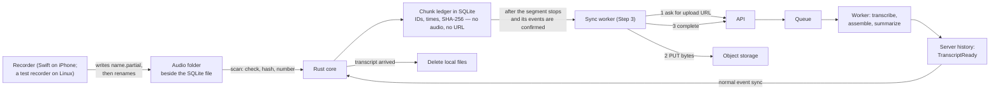

# Phase 5 Step 4 (Rust half): recordings the phone can trust

Implementation record, 2026-11-18. This follows the [Step 3 sync record](phase5-step3-implementation.md). It covers the Step 4 work that runs on Linux: everything Rust does with audio after a recorder produces it. The iPhone recorder itself (microphone permission, the audio session, the encoder, calls and route changes) is Swift work for the Mac and is not done yet.

## What this step adds

Before this step, the phone could mark "recording started" and "recording paused," but no audio existed anywhere. Now the Rust core can take ownership of audio files, check them, keep them in order, upload them when the connection allows, and delete them once the server has turned them into a transcript.

A segment is one stretch of recording for one patient, from a start tap to a pause, a patient switch, a consent change, or the end of the shift. A segment is cut into chunks of about 30–60 seconds. After this step:

- every chunk belongs to exactly one segment, and so to exactly one patient;
- chunks are numbered 0, 1, 2… with no gaps the server could stall on, and exactly one is marked final;
- nothing uploads until the segment has stopped and its start/stop events are on the server;
- a lost reply is retried with the same chunk identity, never a new one;
- after a crash, the recording is closed at the last moment the audio proves;
- the phone deletes its copy only after the server's assembled transcript arrives.

## The picture from the top



## The hand-off: a folder, a name, a rename

We agreed that Swift records and encodes each chunk to a file and hands Rust only the finished chunk. The hand-off is the file itself; no audio or file path is passed as a function argument.

The core gives the recorder a folder when a segment starts: `<database file>.audio`, next to the SQLite file so it shares the same storage and file protection. The recorder writes each chunk under a temporary name ending in `.partial`. When the encoder has finished and flushed the file, the recorder renames it to:

```
<segment id>_<position>_<audio start ms>_<audio end ms>.<wav|m4a|ogg|mp3>
0198f1c0-…-7000_2_1763500120000_1763500150000.m4a
```

The rename is the moment of hand-off. The core then picks the file up the next time it scans: when Swift nudges it, after every pause or stop, and when the app opens.

Passing nothing across the bridge avoids a race. A chunk can finish at the same moment the clinician taps pause. If Swift had to call into Rust to deliver that chunk, the call would queue behind the pause, which is waiting for the recorder to stop. With a folder there is nothing to wait for: the recorder renames its last file before `stop()` returns, and the core scans right after.

The recorder must follow five rules. They are written into [audio.rs](../../crates/er-device/src/audio.rs):

1. A new segment ID for every start; never reuse one.
2. Positions start at 0, go up by one, and are renamed in that order.
3. Start and end times are the audio's own wall-clock capture times, not file times.
4. `stop()` returns only after every chunk, including the trailing partial one, is renamed into place.
5. Never touch a file after renaming it.

Rust decides which chunk is final; Swift does not. If the app is killed, Swift never gets the chance to say "this was the last one," so Rust has to be able to decide anyway. Doing it the same way every time keeps one rule.

## Follow one recording

Dr. Lee records Room 4 (ambient, consent granted), pauses, resumes, then switches to Hall 3 and dictates (solo):

| What happens | Files in the folder | Ledger |
|---|---|---|
| Start Room 4 at 10:01 | — | segment A1 begins |
| 10:02, 10:03 | `A1_0_…`, `A1_1_…` | two chunks, index 0 and 1, queued, not final |
| Pause at 10:03:20 | `A1_2_…` (flushed by stop) | index 2 added; A1 sealed; index 2 is final |
| Resume at 10:04 | — | new segment A2, indices restart at 0 |
| Switch to Hall 3 at 10:05 | `A2_0_…` | A2 sealed; index 0 is final |
| Solo dictation 10:06–10:07 | `B1_0_…`, `B1_1_…` | B1 sealed; index 1 is final |
| Next sync | (unchanged) | push the six start/stop events, then upload six chunks in order |
| Worker finishes | (unchanged) | server writes three TranscriptReady events |
| Next sync pulls them | folder empty | six chunks processed |

The end-to-end test runs exactly this sequence. The echo transcriber turns each WAV's payload back into words, so it can prove Room 4's first recording came back as `alpha / bravo / charlie` in that order.

## No chunk crosses a patient or a pause

A chunk is accepted only if it fits inside its segment:

- it starts no earlier than the segment's start, and ends no later than its stop (or now, while recording);
- it does not overlap the previous accepted chunk;
- it is at most five minutes long.

Control taps and the audio clock can disagree slightly, so each boundary allows two seconds of slack.

A file that arrives after its segment was sealed is refused as `late_chunk`. Nothing is appended to a closed segment. Switching patients, a consent change, and ending the shift all stop the segment the same way a pause does. A revocation therefore closes the recording at the revocation time, and later audio cannot be added to it.

The core also checks each file before taking ownership:

- it must be a real file, not a symlink;
- it must be non-empty and at most 16 MiB (the server's limit);
- it must be a structurally complete file of the type its extension claims.

The last check catches a mislabeled file, a truncated WAV, and an M4A whose index (`moov`) was never written. That last case is what a killed encoder usually leaves behind.

Refused files keep their reason in the ledger and stay on disk, so nothing disappears silently. Files the core does not recognize are left alone and counted: odd names, segments that never existed, and leftover `.partial` files.

While a segment is still recording, the core waits at a gap. If position 3 is renamed before position 2, nothing past 2 is taken until 2 arrives. Once the segment has stopped, a gap is permanent and is counted as a missing chunk.

## Uploading, and what is stored

Uploads use the Step 3 sync worker and its request budget. For each chunk the worker makes three calls:

1. **Upload URL:** ask the API for a 15-minute signed upload URL (`POST …/encounters/{segment}/audio`).
2. **Upload:** re-read the file, check that its length and SHA-256 still match what was checked at hand-off, and `PUT` it to object storage.
3. **Confirmation:** ask the API to verify the object and queue transcription (`POST /v1/audio/{chunk}/complete`).

The signed URL is a password for one upload, so it lives only inside that one network action and never reaches SQLite. The test reads the raw SQLite file and its write-ahead log to prove this.

Audio work for a patient starts only when two things are true:

- **The segment has stopped and been sealed.** Its final chunk is known.
- **The patient's queue of unsent events is empty.** The segment's start and stop events are already on the server. The server ignores a transcript for an encounter it has never heard of, so the order matters.

Chunks upload lowest index first, so the final chunk is always the last one sent.

## When a reply disappears

| What was lost | What the phone does next | Result on the server |
|---|---|---|
| The reply to the upload | The chunk still looks unsent, so it asks for a URL again (same chunk ID) and uploads again | Same row; the server's version binding keeps the first completed bytes |
| The reply to "complete" | Calls complete again with the same chunk ID | Same row; the worker ignores a duplicate job |
| The bytes never arrived (`409 chunk_not_uploaded`) or the row is missing (`404`) | Goes back to "upload" | One row |
| A permanent refusal for this chunk (other 400/409 codes) | Marks only that chunk refused, with the server's code | Other chunks and patients carry on |
| Offline, 401, 429, 5xx | Step 3's handling: refresh the token, back off, retry later | Nothing changes |

## After a crash

If the app dies mid-recording, Step 2 already reopened the patient as "interrupted." The question it left open was where the recording ended. Step 2 left that to the caller, with this note: "supplied by the Rust test harness now and the hardware manifest policy in Step 4."

The chunk files are that evidence. On reopen, the core collects every chunk renamed before the crash. `recover_interrupted(patient)` then closes the segment at the end of the last accepted chunk, or at the segment's start if there were none. It seals the segment with that chunk as final. A caller-supplied boundary earlier than that point is refused, because it would cut off audio the phone already holds. A leftover `.partial` file is counted and never uploaded.

## When the phone deletes audio

The server writes `TranscriptReady` for a segment only after every chunk of it has finished transcription. When that event arrives on the phone through normal sync, the chunks are marked processed and their files are deleted. The mark is saved first and the file deleted second, so a crash in between only leaves a file for the next pass to remove. This is the earliest moment the plan allows ("delete only after durable processing acknowledgment"). Step 9 can make retention longer; the rule lives in one function.

## A Step 3 bug the end-to-end test found

The first full run failed on the phone's second sync, after the worker had written its summary. The phone checks that each pulled event's server timestamp equals the time inside the event.

- **The cause:** The worker stamps its events with nanosecond times. Postgres keeps only microseconds, so the two differ by under a microsecond, and the phone rejected the page as corrupt.
- **The impact:** Every phone sync would have broken once the worker summarized anything. Step 3's tests never ran the worker.
- **The fix:** The phone now compares at microsecond precision and no coarser ([sync_core.rs](../../crates/er-device/src/sync_core.rs)). A unit test pins the boundary.

## What the Mac work must add

The bridge was deliberately left unchanged: no new exports, no regenerated Swift. When the Swift side is built, the bridge needs to gain:

- **The recorder adapter:** the `CaptureAdapter` trait as a callback interface (`available`, `start(patient, segment, solo, directory)`, `stop`), implemented in Swift with AVFoundation and following the five rules above.
- **Recording commands:** `start_capture`, `pause`, `collect_audio` (the nudge), `audio_status`, and `recover_interrupted`, which Step 2 kept out of the production bridge.
- **An encoder choice:** AAC in an `.m4a` file is the likely default. Check that a killed recorder never leaves a renamed file without its index; the core will refuse one, but the audio is lost. Opus is unverified.
- **The device-only checks:** an hour-long recording on a real phone, calls, route changes, locking, backgrounding, the app being killed, and a battery baseline.

## Files

| File | What it does |
|---|---|
| [er-device/src/audio.rs](../../crates/er-device/src/audio.rs) — new | The hand-off contract: file naming, size/length limits, container completeness checks. |
| [er-device/src/audio_core.rs](../../crates/er-device/src/audio_core.rs) — new | Scanning, checking and numbering chunks; sealing; crash-recovery boundary; deleting after transcripts; the audio status view. |
| [er-store/src/audio.rs](../../crates/er-store/src/audio.rs) — new | The chunk ledger: insert, seal, next work item, compare-and-set state changes, counts. |
| [er-store/src/db.rs](../../crates/er-store/src/db.rs) | SQLite schema version 3: the `device_audio_chunks` table. |
| [er-device/src/sync.rs](../../crates/er-device/src/sync.rs), [sync_core.rs](../../crates/er-device/src/sync_core.rs) | Upload and complete actions, refusal handling, scheduling after event delivery, and the timestamp fix. |
| [er-device/src/core.rs](../../crates/er-device/src/core.rs), [handle.rs](../../crates/er-device/src/handle.rs), [views.rs](../../crates/er-device/src/views.rs) | Audio folder, adapter signature, settle after stops and on open, evidence-checked recovery, test-only handle with a recorder, `AudioView`. |
| [ios/Config/Shared.xcconfig](../../ios/Config/Shared.xcconfig) | Simulator builds are Apple-silicon only, matching the XCFramework (Bridge Apple CI fix). |

## Tests: what was actually exercised

- **[Store tests](../../crates/er-store/src/audio_tests.rs)** (3 new): uniqueness per file, position and index; exactly one final chunk at the highest index; no upload work for an unsealed segment; compare-and-set state changes; a rejected chunk keeps its index.
- **[Device tests](../../crates/er-device/src/audio_tests.rs)** (7 new, plus 2 in `audio.rs` and 1 for the timestamp fix). They use a recorder that writes real files with the `.partial`-then-rename pattern:
  - pause seals three ordered chunks, and resume starts again at index 0;
  - an hour of 60 one-minute chunks, renamed out of order, comes out contiguous with one final chunk;
  - patient switch, late file, before-start and after-pause files are all refused correctly;
  - mislabeled, empty, symlinked and over-long files are refused, and unknown files are left alone;
  - consent revocation seals at the revocation, blocks ambient restart, and still allows solo;
  - a crash mid-recording recovers at the last chunk;
  - files are deleted only after the transcript arrives.
- **[Real-pipeline tests](../../crates/er-server/tests/device_audio_gate.rs)** (2 new). They run against PostgreSQL, RustFS, ElasticMQ and the real worker with the echo transcriber:
  - the Room 4 / Hall 3 sequence above: server rows per encounter, no presigned URL in SQLite, correct assembled transcripts, files deleted on the phone;
  - lost upload reply, lost completion reply and missing object, each retried without a new chunk identity, with the original audio preserved.

| Check | Result on Linux |
|---|---|
| `er-store` unit tests | 12 pass (3 new) |
| `er-device` unit tests | 27 pass (10 new) |
| New real-pipeline tests | 2 pass |
| Step 3 real-server sync tests | 7 pass |
| `cargo fmt --check`, `cargo clippy --workspace --all-targets -D warnings` | Pass |
| `scripts/check-device-deps.sh` | Pass (both Apple target graphs) |
| `scripts/check-bridge-linux.sh` | Pass; generated bindings unchanged |
| `scripts/ci-services.sh` (full workspace on disposable services) | See the hand-off note |
| Xcode, simulator, physical iPhone | Not run; Mac work |

## Tradeoffs and open items

- **Uploads wait for a pause.** Step 3 deliberately blocks sync while recording. A long recording therefore uploads after it stops. An hour of one-minute chunks is about 120 API calls, which takes a few minutes under the 30-per-minute upload quota. Uploading during a recording would need that block relaxed for audio-only work.
- **A segment with no usable audio never gets a transcript.** For example, the microphone produced nothing, or every file was refused. The server only writes `TranscriptReady` when a final chunk exists, and the note cannot reach review while an encounter has no transcript. The audio view counts these segments. **Decision needed:** how such a segment should be closed. One option is a server-side "no audio captured" marker; uploading generated silence would be the other, but it fabricates audio.
- **A chunk refused after acceptance stalls its segment on the server.** Assembly waits for every index. The phone keeps the gap visible, but the server has no "this chunk is lost" call to let assembly continue with a gap marker. That is a small server addition worth making before real use.
- **Retention is minimal.** Phone audio is deleted at the earliest allowed point. Refused, unrecognized and leftover partial files stay on disk for Step 9's cleanup policy.
- **Hashing happens on the command thread.** It is fine for 30–60 second chunks (well under 2 MB). Much larger chunks would delay taps while a file is hashed.
- **Chunk status polling is unused.** The arrival of `TranscriptReady` already says every chunk of the segment finished, at no extra request cost. A per-chunk progress display would need polling.
