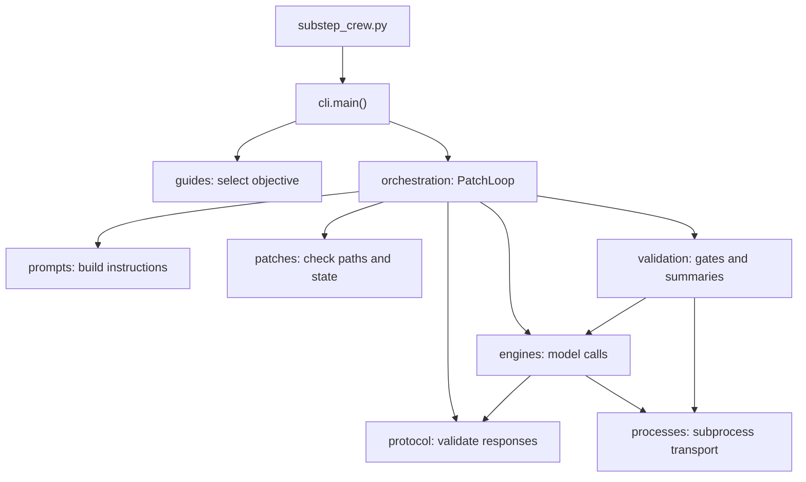
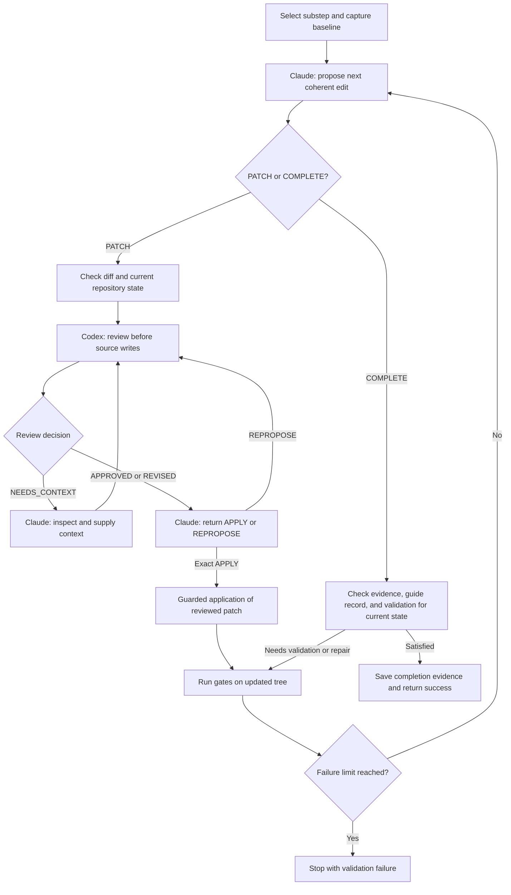

# Substep crew: a tour through the code

The runner completes one planning-guide substep through a series of coherent
edits. Claude plans each edit and requests its application. Codex reviews the
proposed diff before any source file changes. Python applies the exact reviewed
diff and runs the configured validation commands.

Keep three units in mind: a **substep** is the whole objective; an **edit** is one
reviewed patch, potentially spanning several files; an **invocation** is one model
call. A substep can contain many edits, and an edit can require several invocations
when Codex needs context or Claude reproposes a change.

The implementation uses Python's standard library. The existing command remains:

```bash
python3 scripts/substep_crew.py --dry-run --phase 4 --step 8 --substep S1
```

## Start here

Read these functions in order to follow the main path:

1. [`cli.main()`](../scripts/substep_crew_lib/cli.py) selects the substep and roles.
2. [`PatchLoop.run()`](../scripts/substep_crew_lib/orchestration.py) asks Claude for
   a patch or completion evidence.
3. `PatchLoop.review_and_apply()` resolves Codex's decision and Claude's application
   request.
4. `PatchLoop.apply_reviewed()` checks the approval and performs the source write.
5. `PatchLoop.validate()` runs the gates and prepares feedback for the next edit.

The other modules support those five functions. Start with the orchestration
module before reading the subprocess and log-processing details.

## Module map

| File | Responsibility | Main functions and classes |
| --- | --- | --- |
| [`substep_crew.py`](../scripts/substep_crew.py) | Small launcher; supports direct execution and `python3 -m scripts.substep_crew` | Imports `main()`; handles interruption |
| [`cli.py`](../scripts/substep_crew_lib/cli.py) | Arguments, setup, dry run, exit codes | `main()`, `_unique_run_dir()` |
| [`config.py`](../scripts/substep_crew_lib/config.py) | Shared workspace paths and model configuration defaults | `REPO`, `RUNS`, `OLLAMA`, `default_claude_config_dir()` |
| [`guides.py`](../scripts/substep_crew_lib/guides.py) | Planning sections and completion tracking | `Substep`, `Guide`, `parse_guide()`, `find_guide()`, `detect_phase_step()`, `committed_substeps()`, `resolve_substep()` |
| [`orchestration.py`](../scripts/substep_crew_lib/orchestration.py) | Edit lifecycle, retries, approval ownership, completion | `PatchLoop` |
| [`prompts.py`](../scripts/substep_crew_lib/prompts.py) | Author and reviewer instructions with the original objective | `substep_context()`, `implement_prompt()`, `patch_review_prompt()` |
| [`protocol.py`](../scripts/substep_crew_lib/protocol.py) | Agent response schemas and strict parsing | Four action schemas, `load_json()`, `parse_response()`, `parse_proposal()`, `parse_patch_review()`, `CrewError`, `ProtocolError` |
| [`patches.py`](../scripts/substep_crew_lib/patches.py) | Patch applicability, path policy, repository fingerprints | `checked_git()`, `safe_path()`, `patch_paths()`, `repository_state()`, `ReviewedPatch` |
| [`engines.py`](../scripts/substep_crew_lib/engines.py) | Model adapters and role factories | `Engine`, `ClaudeEngine`, `CodexEngine`, `OllamaEngine`, `PROFILES` |
| [`processes.py`](../scripts/substep_crew_lib/processes.py) | Subprocess execution and output capture | `Result`, `run_process()`, `_Excerpt`, process-group cleanup helpers |
| [`validation.py`](../scripts/substep_crew_lib/validation.py) | Actual validation commands and concise diagnostics | `Gate`, `GATE_SETS`, `run_gates()`, `condense()` |

This diagram shows the main runtime calls. Shared defaults live in `config.py`;
they are read by the modules that need repository or artifact paths.



There is no registry that forwards calls back into the launcher. Internal imports
name their owning modules explicitly, such as `patches.patch_paths(...)`. Tests
mock those same module boundaries.

## 1. Select the objective: `cli` and `guides`

`main()` parses the flags, reads recent commit subjects, and finds a guide under
`docs/planning`. Explicit `--phase` and `--step` select the guide; otherwise the
most recent matching commit supplies the phase and step.

`parse_guide()` builds two data objects:

- `Substep`: its ID, title, heading line, and complete original section text.
- `Guide`: its path, phase, step, substeps, and IDs with implementation records.

`resolve_substep()` combines guide records and matching git commit subjects to
choose the first unfinished substep. An explicit `--substep` overrides that
selection. `Guide.get()` retrieves the selected section; `Guide.rel` supplies its
repository-relative path for prompts and patch checks.

`engines.PROFILES` contains factories for `implementer`, `reviewer`, and
`condenser`. The default profile uses Claude, Codex, and Ollama respectively. The
`local` and `claude-only` profiles use the same orchestration and write checks.

`--dry-run` prints the objective and review prompts, then returns before creating
run artifacts or invoking models or gates. A real run creates a unique directory
under `.agents/runs/`, saves `baseline.diff`, and constructs `PatchLoop`.

## 2. Own the lifecycle: `PatchLoop`

One `PatchLoop` instance owns all state for one substep. Its original objective
comes from the selected guide section and remains fixed throughout the run.

| Field | What it represents |
| --- | --- |
| `objective`, `review_objective` | Original objective, completion criteria, baseline, and pre-existing changes |
| `context_paths` | Guide and additional files supplied as context |
| `expected_state` | Fingerprint of the repository version the loop expects |
| `pending` | Current in-memory `ReviewedPatch`, or `None` |
| `history` | Applied patch text, review decision, explanation, and before/after fingerprints |
| `needs_validation` | Whether the most recent edit still needs its required gates |
| `last_gates`, `gate_text` | Actual command results and their bounded summary |
| `validated_state` | Repository fingerprint associated with the latest validation |
| `failed_rounds` | Consecutive failed validations; a passing validation resets it |

`run()` asks Claude for either `PATCH` or `COMPLETE`. Every proposal includes the
earlier applied changes, last validation summary, current fingerprint, and diff
against HEAD. Claude's read tools inspect the current repository.

For `PATCH`, the loop checks the proposed diff, resolves its review and application,
then validates the resulting tree before requesting another edit. Passing gates
after one edit allow progress; completion still requires evidence for the entire
substep and its implementation record.



Malformed responses and failed model calls have bounded retries. Stale state,
unsafe context paths, missing guide records, and exhausted limits stop the run.
Those error paths are described below; they never create an alternative writer.

## 3. Collaborate on one edit: `prompts`, `protocol`, and review

`implement_prompt()` tells Claude to plan one coherent edit against the current
files. `patch_review_prompt()` gives Codex the objective, proposed diff, relevant
existing file contents, earlier applied patches, and actual validation summary.

The review response is a JSON object with four required fields: `decision`,
`patch`, `explanation`, and `context_requests`.

| Decision | Patch | Next action |
| --- | --- | --- |
| `APPROVED` | Exactly the proposed patch string | Ask Claude to apply that exact patch |
| `REVISED` | Complete replacement diff against the same current files | Ask Claude to apply the returned patch |
| `NEEDS_CONTEXT` | Empty string | Ask Claude for inspected context, then review again |

`parse_patch_review()` enforces those distinctions. An approval with altered text
is invalid. A revision must differ from the proposal and explain its change. A
context request must contain non-empty requests and no implementation.

After an approval or revision, `review_and_apply()` creates a frozen
`ReviewedPatch` holding the reviewed text, base fingerprint, decision, and
explanation. Claude then returns an `APPLICATION_SCHEMA` response:

- `APPLY`: the patch must match the review exactly.
- `REPROPOSE`: invalidate the pending approval and submit the complete modified
  patch through another review.

JSON schemas constrain model output, and Python checks it again. `load_json()`
rejects duplicate fields, invalid numeric constants, and invalid Unicode;
`parse_response()` checks types, required fields, enums, and extra fields.

```mermaid
sequenceDiagram
    participant H as PatchLoop
    participant C as Claude
    participant X as Codex
    participant R as Repository
    H->>R: Read current state and relevant files
    H->>C: Objective, earlier patches, current state, validation
    C-->>H: PATCH proposal
    H->>X: Objective, proposal, existing code, history
    alt Essential context missing
        X-->>H: NEEDS_CONTEXT, empty patch
        H->>C: Inspect requested context
        C-->>H: Context and paths
        H->>X: Review with expanded context
    end
    X-->>H: APPROVED unchanged, or REVISED complete diff
    H->>C: Request application of exact reviewed patch
    alt Claude accepts the returned patch
        C-->>H: APPLY with identical patch text
        H->>R: Recheck approval, state, and applicability; git apply
        H->>R: Run fixed validation commands
        R-->>H: Actual gate results
        H->>C: Prepare next proposal using updated state
    else Claude changes the patch
        C-->>H: REPROPOSE with complete modified patch
        H->>X: Start fresh review before application
    end
```

## 4. Reach the write boundary: `apply_reviewed` and `patches`

`PatchLoop.apply_reviewed()` is the source-edit boundary. It checks that:

1. The supplied receipt is the exact object currently in `pending`.
2. The requested patch equals the reviewed patch text.
3. The preceding applied patch has already been validated.
4. The current repository fingerprint matches the approval's base.
5. The patch still passes path and applicability checks.

It checks the fingerprint again, consumes the approval, and calls
`patches.checked_git('apply', '--whitespace=nowarn', input_text=patch)`. It then
records the new state and history and marks validation as required. It neither
stages nor commits. A failed application does not automatically reuse approval.

`patch_paths()` uses `git apply --numstat` and `git apply --check` to inspect a
diff without applying it. `safe_path()` checks repository containment, regular
files, symlinks, ignored paths, and protected locations. A coherent diff may
contain 1–32 files and at most 200,000 characters. Binary files, symlink/submodule
edits, and rename/copy metadata are unsupported; a text rename can use delete/add.

`repository_state()` fingerprints HEAD, index entries, file modes, and contents
of tracked and nonignored untracked files, including deletions. Known context
paths and the selected guide are included even when ignored. Run artifacts are
excluded, so saving a transcript does not invalidate a review. Source files are
hashed by content rather than by `git status` alone.

`assert_current()` compares the expected fingerprint before and after model calls,
around validation, and at application. A mismatch invalidates approval and stops
the run. It never silently rebases a reviewed patch.

## 5. Call models and run commands: `engines` and `processes`

Every adapter implements `Engine.run(prompt, timeout, schema, log_path=...)` and
returns a `Result`. This interface also accepts the scripted fake engines in the
tests; the loop does not depend on a model SDK.

`ClaudeEngine` permits only `Read`, `Glob`, and `Grep`, disables MCP tools and custom
hooks, and captures its complete structured final response separately from noisy
transcripts. Authentication configuration is selected by
`config.default_claude_config_dir()`, honoring `CLAUDE_CONFIG_DIR` first.

`CodexEngine` requires the read-only sandbox, disables approvals and integrations,
and reads the complete final message from the CLI's output file. Both authors and
reviewers therefore request source edits through the Python dispatcher.

`OllamaEngine` performs tool-free HTTP chat. Its condenser role extracts unknown
gate diagnostics; it has no patch-application role.

`run_process()` provides stdin for large prompts, streams complete transcripts to
disk, and retains bounded head/tail excerpts in memory. `_Excerpt` handles that
bounded capture. On POSIX, timeout/interruption cleanup signals the owned process
group, escalates to SIGKILL after a grace period, and cleans up descendants.

## 6. Validate, then plan from the updated tree: `validation`

`run_gates()` chooses fixed commands from `GATE_SETS`. Rust gates run format checks,
clippy, and tests; Terraform gates run the existing guard scripts. `all` combines
them, while `none` explicitly opts out of deterministic validation.

Each command produces a `Gate` with its real exit status, elapsed time, excerpt,
and full transcript path. `condense()` first extracts known diagnostics directly
from logs. For unfamiliar failures it may ask the tool-free condenser for
structured details. Python formats the bounded summary; the condenser cannot
replace the command's exit status or declare a failed gate passed.

`PatchLoop.validate()` binds results to `validated_state`. Failed gates return to
Claude for another reviewed edit while the failure budget allows. No subsequent
edit can be applied before this validation runs. Completion requires a guide
implementation record, non-empty criterion/evidence entries, and passing selected
gates for the same repository state. If completion is requested before that state
has been validated, the loop validates and requests fresh completion evidence.

### Walk through two edits

Suppose `a.py` starts with `value = 0`. Claude proposes changing it to `1` and Codex
revises that diff to use `2`. Claude returns the exact revised diff as `APPLY`.
The dispatcher writes `value = 2`, records that patch and the new fingerprint,
then validates it. Claude's next proposal and Codex's next review both see
`value = 2` and the earlier revision. An old diff against `value = 0` fails
applicability checks. Changing an unrelated tracked file during a model call also
invalidates the expected fingerprint and stops application.

## Failure handling and artifacts

`invoke()` handles one model call, checks state, and saves its evidence. `call()`
retries protocol failures up to `--review-attempts`, with the error included in
the next prompt. `review_and_apply()` separately bounds the full review exchange,
including context requests and reproposals, by the same setting.

`ProtocolError` represents a retryable response or invocation failure, including
timeouts. `CrewError` represents a stop such as stale state or exhausted retries.
`--max-edits` limits applied edits; `--max-rounds` limits consecutive failed
validations. These limits do not grant an unchecked final edit.

`main()` returns `0` for ready/dry-run, `1` for exhausted validation failures, and
`2` for an explicit orchestration or I/O failure. Argument errors also use `2`;
the launcher handles interruption with `130`. Previous successfully applied edits
remain in the working tree when a later operation fails.

Inspect the run directory printed by the CLI:

| Artifact | What it lets you inspect |
| --- | --- |
| `baseline.diff` | Changes that existed before this run |
| `*.schema.json` | Expected response shapes |
| `NNN-role-kind.prompt.md` | Exact prompt for each invocation |
| `NNN-role-kind.transcript.log` | Complete CLI transcript |
| `NNN-role-kind.final.json` | Complete transport response; Claude may retain its outer result envelope |
| `NNN-role-kind.validated.json` | Parsed response accepted by the dispatcher |
| `NNN-applied.patch`, `applied-history.json` | Exact applied patches and their state history |
| `NN-gate-*.transcript.log`, `NN-gates.summary.md` | Full validation output and bounded feedback |
| `completion.json` or `error.txt` | Completion evidence or explicit stop reason |

Artifact files aid inspection; loading one does not restore or grant an approval.

## Tests and places to extend

Run the mocked suite without writing bytecode:

```bash
PYTHONDONTWRITEBYTECODE=1 python3 scripts/test_substep_crew.py
# The package launch also works:
PYTHONDONTWRITEBYTECODE=1 python3 -m unittest scripts.test_substep_crew
```

[`test_substep_crew.py`](../scripts/test_substep_crew.py) covers exact approved and
revised patches, successive edits, context exchanges, retries, stale state,
failed reviews, required validation, CLI imports, and both launcher forms.
Temporary git repositories exercise real patch checks/application, while model
responses and validation commands are mocked. Process tests exercise actual
streaming and timeout cleanup.

To change instructions, edit `prompts.py`. To change an agent's transport, edit
`engines.py`; to change gate commands, edit `validation.GATE_SETS`. Response shapes
belong in `protocol.py`. Workflow transitions belong in `PatchLoop`, and patch
policy belongs in `patches.py`. Preserve the approval checks in `apply_reviewed()`
when extending any code-changing behavior.

[`benchmark_substep_crew.py`](../scripts/benchmark_substep_crew.py) is optional. It
imports the process runner directly and retains the retired blocker-matching
algorithm only for performance comparisons; that algorithm is outside the agent
loop.

## Current limits

The runner assumes one writer. Fingerprints detect intervening changes but cannot
lock out an arbitrary external process between the last check and `git apply`.
Full context files are limited to 1 MiB each. Supported source edits are UTF-8
text patches for regular files. Process-group cleanup is POSIX-specific; other
platforms use best-effort child signaling. The mocked tests do not verify live
Claude/Codex installations, authentication, or model quality.

The diagrams are Mermaid source and render in Markdown viewers with Mermaid
support, including GitHub. Their labels correspond to the module and method
names above, so they can be edited alongside the code.
